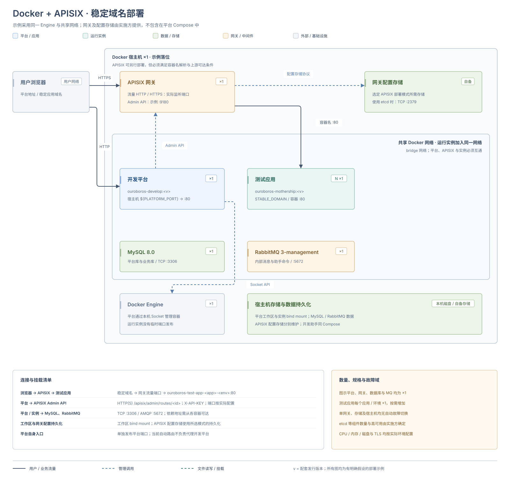

# Docker + APISIX 部署

本方式由 Docker 承载测试应用，由 APISIX 提供稳定域名入口。开发平台仍可使用 Compose 安装；平台通过 Docker API 管理容器，通过 APISIX Admin API 同步路由。拓扑见 [Docker + APISIX 架构](../deployment-architecture#docker-apisix)。

当前自动路由集成处理 `DOCKER` 后端的 `TEST_APP`，访问策略为 `STABLE_DOMAIN`。内部开发助手继续使用 `INTERNAL_ONLY`；Kubernetes 的域名入口按 [Kubernetes 部署](./kubernetes#ingress) 配置。

## 部署架构



图中采用同一 Docker 宿主机和共享网络，平台、APISIX、MySQL、RabbitMQ 各一个实例；这种落位存在主机与单网关故障点。APISIX 所需配置存储及其副本、持久化由实施方准备，图示不承诺网关或数据库高可用。

实线表示用户或业务流量，蓝色虚线表示管理调用，绿色虚线表示文件读写或挂载。APISIX 的管理接口与浏览器流量入口分别配置，平台自身的访问入口单独维护。

## 环境要求

除 [Compose 环境要求](./docker-compose#environment) 外，还需准备：

| 对象 | 要求 |
| --- | --- |
| APISIX | 单独部署 APISIX 及所选部署模式需要的配置存储；平台 Compose 不包含 APISIX 或 etcd |
| 管理接口 | 平台可访问可写的 `/apisix/admin/routes/` 接口，并持有 Admin API 密钥；只读取本地 YAML 的独立模式不适用 |
| 应用网络 | APISIX 与目标测试应用在同一 Engine 的共享 Docker 网络中，可按容器名称互访 |
| 浏览器入口 | DNS 指向 APISIX 流量入口，按使用范围准备端口、TLS 和证书 |
| 平台入口 | 单独维护开发平台地址与证书；本集成不会自动代理开发平台自身 |

APISIX 的 Admin API 地址用于平台管理调用，流量入口供浏览器访问，两者分别配置。实例上游为 `ouroboros-test-app-<应用名>-<环境>:80`，需要 Docker 名称解析。

## 1. 安装并初始化开发平台

按 [Docker Compose 部署](./docker-compose) 完成环境检查、目录与持久化配置、平台启动和 [首次登录](./docker-compose#6-首次登录)，并准备配套基座镜像。新增域名模式前，先验证平台和依赖可用。

已有平台保留原有工作区、数据库和凭据，先备份配置。使用远程 Engine 时，同时满足 [远程 Docker Engine 部署](./remote-docker) 的共享工作区与依赖连接要求。

## 2. 准备共享网络和 APISIX

在运行测试应用的 Docker Engine 上确认实际网络。配套 Compose 的网络键为 `ouroboros-dev`，实际名称通常带 Compose 项目前缀，不能直接假定名称与配置键相同。

同机部署可检查平台所在网络：

```bash
docker inspect ouroboros-develop --format '{{json .NetworkSettings.Networks}}'
```

将 APISIX 接入承载测试应用的网络，并在下一步显式指定实例网络。远程 Engine 上应选择远端实际网络。APISIX 还需要访问其配置存储；平台需要访问 APISIX Admin API。

## 3. 注入网关配置

将下列字段合并到现有 Compose 平台服务的 `environment` 中，保留镜像、数据库、RabbitMQ、挂载和其他配置。把 `runtime-network`、Admin API 地址及域名后缀替换为实际值，并在 `.env` 中设置 `APISIX_ADMIN_KEY`。

```yaml
services:
  ouroboros-develop:
    environment:
      OUROBOROS_DEV_RUNTIME_DEFAULTBACKEND: DOCKER
      OUROBOROSDEV_CONTAINER_DEFAULTNETWORKNAME: runtime-network
      OUROBOROS_DEV_RUNTIME_GATEWAY_ENABLED: "true"
      OUROBOROS_DEV_RUNTIME_GATEWAY_PROVIDER: apisix
      OUROBOROS_DEV_RUNTIME_GATEWAY_STABLEDOMAINHOSTSUFFIX: develop.example.com
      OUROBOROS_DEV_RUNTIME_GATEWAY_APISIX_BASEURL: http://apisix:9180
      OUROBOROS_DEV_RUNTIME_GATEWAY_APISIX_ADMINKEY: ${APISIX_ADMIN_KEY:?Set APISIX_ADMIN_KEY in .env}
      OUROBOROS_DEV_RUNTIME_GATEWAY_APISIX_ROUTEIDPREFIX: tidestack-dev
```

`APISIX_ADMIN_KEY` 只是本例的 Compose 插值变量，实际传入平台的是 `OUROBOROS_DEV_RUNTIME_GATEWAY_APISIX_ADMINKEY`。仅向 `.env` 添加变量不会自动传入平台容器。完整 Spring 键与环境变量映射见 [稳定域名网关配置](../development-platform-configuration#稳定域名网关)。

检查后重建平台服务，使环境变量生效：

```bash
docker compose config --quiet
docker compose up -d --no-deps --force-recreate ouroboros-develop
docker compose logs --since 10m --tail 500 ouroboros-develop
```

## 4. 选择稳定域名并创建实例

在平台配置中心设置下列默认值，或在本次创建请求中显式选择：

| 配置中心键 | 值 |
| --- | --- |
| `dev-app-management.test-app.preferred-runtime-backend` | `DOCKER` |
| `dev-app-management.test-app.default-exposure-strategy` | `STABLE_DOMAIN` |

这两个键不支持直接通过 Spring 环境变量注入。创建请求优先于配置中心默认值，修改默认值不会改变已有实例；使用新建测试实例验证。

例如应用 `crm`、环境 `dev`、后缀 `develop.example.com` 对应 `crm-dev.develop.example.com`。为实际后缀准备 DNS，按需使用通配解析和证书。平台同步该主机下的 `/*` 路由，不额外生成独立 API 域名。

## 5. 验证访问和路由生命周期

1. 确认新实例的后端与访问策略为 `DOCKER` / `STABLE_DOMAIN`。
2. 在 APISIX 确认平台创建的路由、主机名及上游 `ouroboros-test-app-<应用名>-<环境>:80` 正确。
3. 确认 APISIX 能在共享网络中解析并访问应用容器。
4. 从用户实际网络打开域名，完成登录、查询和一次测试写入；使用 HTTPS 时检查实际证书。
5. 停止、重新运行并删除专门用于验收的测试实例，分别检查路由更新或删除及访问结果。

平台使用带 `X-API-KEY` 的 Admin API 请求维护 `/apisix/admin/routes/<路由ID>`，运行、停止或删除实例时同步对应路由。容器状态与路由状态分别检查；稳定域名模式不按临时端口策略发布宿主机应用端口。

交接时一并记录平台配置、APISIX 配置存储与恢复方式、密钥保管位置、共享网络、DNS、证书和入口。日常巡检见 [监控与告警](../monitoring-and-alerting)，部署模式边界见 [APISIX 官方说明](https://apisix.apache.org/docs/apisix/deployment-modes/)。
