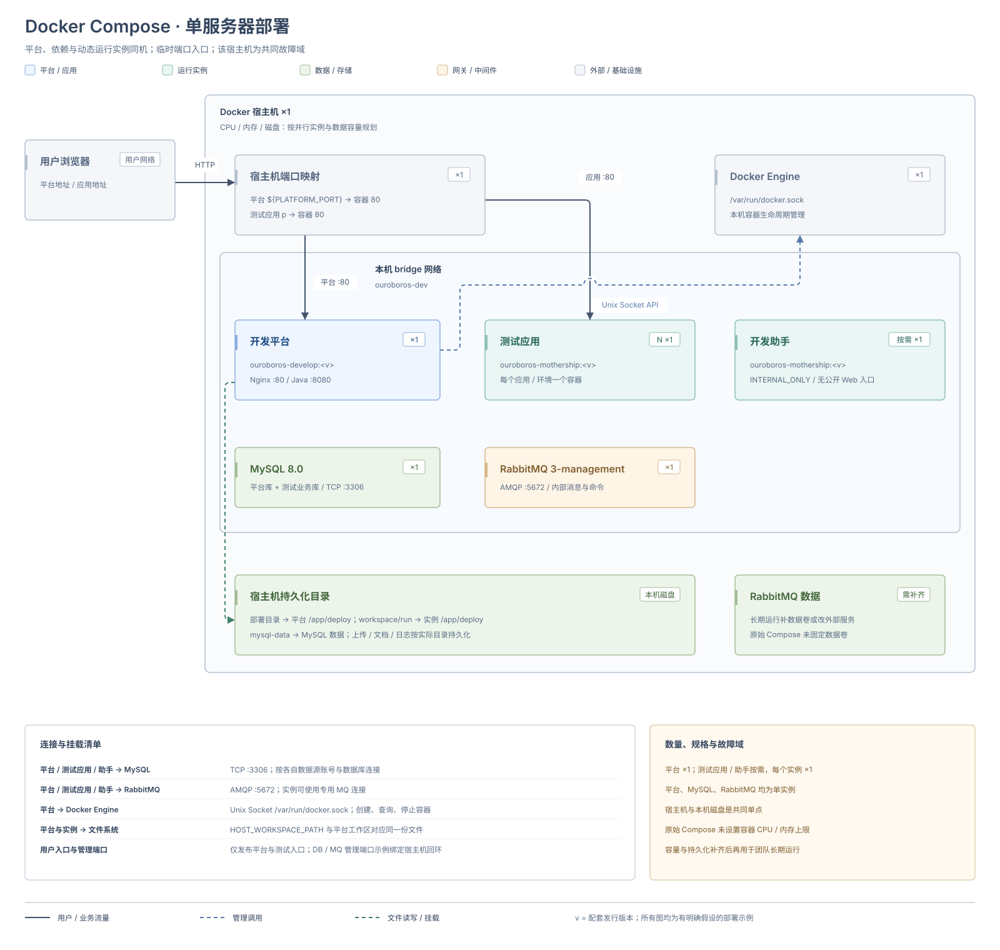
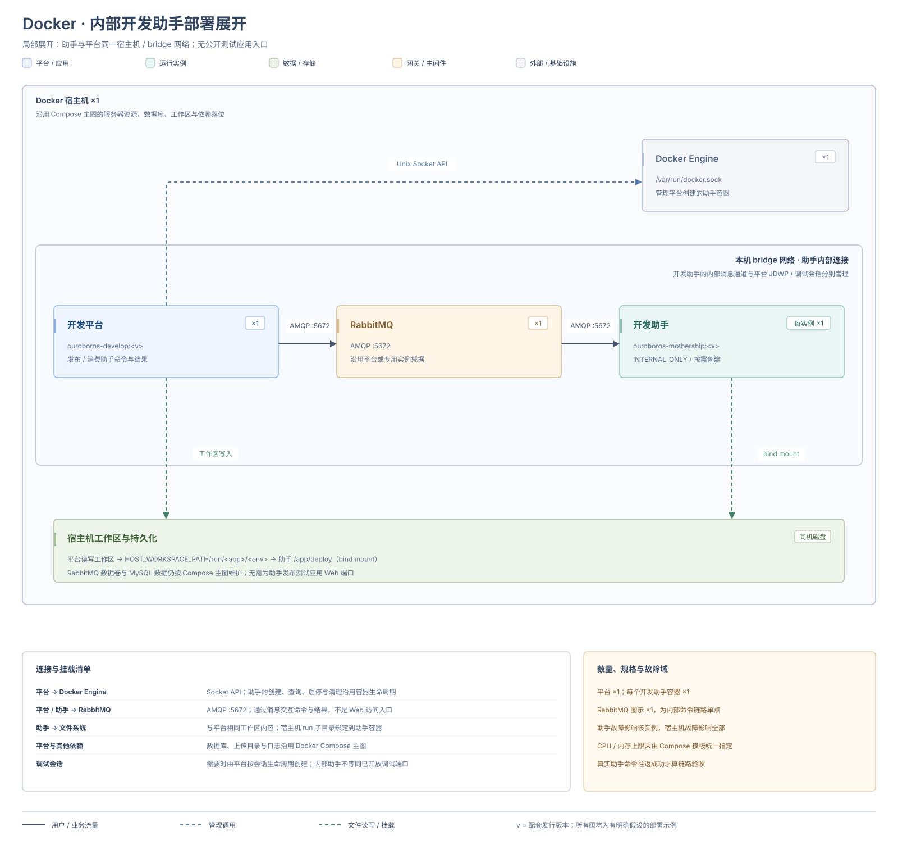

# Docker Compose 部署

本页使用配套 Compose 在同一主机安装开发平台、MySQL 和 RabbitMQ，并由 Docker 按需创建测试应用与内部开发助手。测试应用默认通过宿主机临时端口访问，拓扑见 [Docker 临时端口架构](../deployment-architecture#docker-port)。

操作使用 Linux / macOS 的 Bash。Windows 个人体验见 [快速上手](../../getting-started/)。需要稳定域名时，完成本页的平台初始化后继续 [Docker + APISIX 部署](./docker-apisix)；跨主机运行实例见 [远程 Docker Engine 部署](./remote-docker)。

参数的默认值、配置来源与覆盖关系见 [统一运行基座配置项](../runtime-base-configuration) 和 [开发平台配置项](../development-platform-configuration)。

## 部署架构



图中以一个宿主机承载平台、数据库、消息队列和按需实例，宿主机与本机磁盘是共同故障域。平台、MySQL 和 RabbitMQ 各为单实例；每个测试应用或助手也为单实例。Compose 模板没有统一设置 CPU、内存上限，需按容量规划配置。

实线表示用户或业务流量，蓝色虚线表示管理调用，绿色虚线表示文件读写或挂载。图下的连接清单补充数据库、消息和目录映射；RabbitMQ 固定数据卷是长期运行时需要补齐的配置。

## 环境要求 {#environment}

本页以配套 Compose 为基线，适用于单机开发平台和团队共享环境。长期业务运行的容量、可用性和依赖版本，需要结合实际业务验证。

### 主机与镜像

| 项目 | 要求 | 检查方式 |
| --- | --- | --- |
| 容器环境 | Docker Engine 或运行 Linux 容器的 Docker Desktop | `docker info` |
| 编排工具 | Docker Compose v2 | `docker compose version` |
| 镜像仓库 | 主机可以访问 `registry.cn-hangzhou.aliyuncs.com` | 安装时执行 `docker compose pull` |
| CPU 架构 | 所用镜像均有对应架构版本 | 核对镜像清单；ARM64 标签存在时才设置 `ARCH_AFFIX=-arm64` |
| 部署目录 | 固定、可写，位于持久化磁盘 | 核对挂载、所有者、可用空间 |
| 时间 | 主机与依赖时钟一致，明确业务时区 | 示例容器使用 `Asia/Shanghai`；任务执行时间另行验证 |

镜像已包含 Java 运行环境。只使用平台镜像部署时，宿主机不需要单独安装 JDK 或 Maven。

示例未提供经过容量压测的统一 CPU、内存和磁盘下限。应结合并行运行实例数、JVM 堆、数据库、文件量和日志增长量规划资源，并保留恢复演练空间。

### 基础依赖

| 组件 | Compose 示例 | 运维要求 |
| --- | --- | --- |
| 开发平台 | `ouroboros-develop:${OUROBOROS_VERSION}${ARCH_AFFIX}` | 固定版本，配套准备同版本 `ouroboros-mothership` 基座 |
| 数据库 | `mysql-server:8.0${ARCH_AFFIX}` | 可创建应用测试数据库、迁移表结构并读写数据 |
| 消息队列 | `rabbitmq:3-management${ARCH_AFFIX}` | 使用独立凭据，持久化需要保留的定义和消息 |
| 开发运行后端 | 默认 Docker | 平台能够访问受控 Docker API；选择集群后端时见 [Kubernetes 部署](./kubernetes) |

这里的数据库和 RabbitMQ 版本来自配套安装示例，不能据此推断其他版本已经过验证。外部数据库或消息服务需要单独核对权限、网络、备份与兼容性。

### 端口与连接方向

| 连接 | 容器内端口或地址 | 示例宿主机映射 |
| --- | --- | --- |
| 浏览器 / 反向代理 → 平台 | `80` | `${PLATFORM_PORT:-80}` |
| 平台 → MySQL | `ouroboros-dev-db:3306` | 仅本机 `127.0.0.1:${MYSQL_PORT:-13306}` |
| 平台 → RabbitMQ AMQP | `ouroboros-rabbitmq:5672` | 仅本机 `127.0.0.1:5672` |
| 管理员 → RabbitMQ 管理界面 | `15672` | 仅本机 `127.0.0.1:15672` |
| 监控系统 → RabbitMQ 指标 | `15692` | 仅本机 `127.0.0.1:15692`；还需确认指标插件已启用 |
| 调试客户端 → 平台 JDWP | `5005` | 仅本机 `${DEBUG_PORT:-15005}`；示例默认未开启调试 |
| 平台 → Docker Engine | `/var/run/docker.sock` | 挂载 Socket，默认不开放 TCP 端口 |

容器之间使用服务名和容器端口。例如，MySQL 宿主机端口为 `13306` 时，平台仍连接 `ouroboros-dev-db:3306`。

运行实例另有自己的 Web、API 和调试端点；以 [运行实例](../../low-code/development-platform-menus/runtime-instance) 详情为准。不要把平台端口当作业务应用端口。

### 目录与持久化

| 内容 | 示例位置 | 要求 |
| --- | --- | --- |
| 部署定义与配置 | `docker-compose.yml`、`.env`、可选 `application.yml`、`config/` | 配置备份包含实际使用的全部文件，凭据限制访问 |
| 开发工作区 | `workspace/` | 宿主机路径与 `HOST_WORKSPACE_PATH` 一致 |
| MySQL 数据 | `mysql-data/` | 稳定磁盘；备份使用数据库导出或一致性快照 |
| RabbitMQ 数据 | 示例未显式配置固定数据卷 | 团队长期运行前补充持久化或使用外部服务 |
| 日志 | 部署目录下 `logs/` 及容器日志 | 按实际输出方式配置采集、轮转与保留 |
| 上传文件与文档库 | 各自配置的存储根目录 | 明确实际挂载和备份位置，见 [文件与文档维护](../runtime-capability-maintenance) |

示例将部署目录挂载到平台容器的 `/app/deploy`。默认工作区位于容器内 `/app/deploy/workspace`，`HOST_WORKSPACE_PATH` 则填写宿主机的 `workspace/` 绝对路径。两者必须对应同一份文件。

如果把工作区放到部署目录之外，仅修改 `HOST_WORKSPACE_PATH` 不够；还要同步容器内工作区的挂载与平台配置。

### 网络与凭据

示例使用 `ouroboros-dev` 网络，网段为 `172.20.88.0/24`。部署前检查它与主机、VPN 和其他容器网络是否冲突；修改网段时同步检查 MySQL 账号来源限制。

首次启动前设置数据库和 RabbitMQ 随机强密码，并确定管理员口令的保管与轮换方式。已有数据卷中的账号不会因为修改 `.env` 自动完成密码轮换。

Linux 和 macOS 同机部署使用 Docker Socket。Windows 本地体验的 Docker Desktop API 设置见 [快速上手](../../getting-started/#3-开启-docker-api)。团队或远程环境使用经过鉴权的受限接入方式，不开放无认证的 `2375`。

## 1. 准备部署目录

下载以下文件，保存到同一个部署目录：

- [docker-compose.yml](../../getting-started/.assets/docker-compose.yml)
- [docker-compose.env.example](../../getting-started/.assets/docker-compose.env.example)

下面以 `/srv/tidestack` 为例；该目录需要已创建且当前用户可写。以下复制命令用于全新环境；已有环境应先备份并核对现有配置，不要重新复制 `.env` 覆盖它。

```bash
DEPLOY_DIR=/srv/tidestack
cd "$DEPLOY_DIR"
mkdir -p workspace mysql-data logs
cp docker-compose.env.example .env
chmod 600 .env
```

目录中应有 `docker-compose.yml`、`.env`、`workspace/`、`mysql-data/` 和 `logs/`。

## 2. 配置版本、工作区和凭据

编辑 `.env`：

| 配置项 | 填写要求 |
| --- | --- |
| `OUROBOROS_VERSION` | 使用发行说明指定的镜像版本 |
| `ARCH_AFFIX` | 仅在对应 ARM64 镜像存在时填写 `-arm64` |
| `PLATFORM_PORT` | 平台对外端口，默认 `80` |
| `HOST_WORKSPACE_PATH` | 本例填写 `/srv/tidestack/workspace` |
| `MYSQL_ROOT_PASSWORD` | 随机强密码 |
| `RABBITMQ_DEFAULT_USER` / `RABBITMQ_DEFAULT_PASS` | 独立账号与随机强密码 |

`ouroboros-develop` 镜像构建在 `ouroboros-mothership` 基座之上；后续创建 Docker 运行实例时，也需要在镜像管理中准备与平台配套的基座镜像。

`HOST_WORKSPACE_PATH` 用于把工作区提供给后续运行实例。它必须与容器内 `/app/deploy/workspace` 对应，不能填写容器内路径。

## 3. 补齐长期运行配置

配套 Compose 是单机起点。用于团队共享前，至少确认以下内容：

- MySQL、工作区、上传目录和文档库均有持久化存储。
- RabbitMQ 使用外部持久化服务，或补充固定节点名与数据卷。
- 日志有采集、轮转和保留策略。
- 对外入口、域名、TLS 和访问范围已确定。
- 备份存储位于独立故障域，并已安排恢复演练。

全新环境可在 `docker-compose.yml` 的现有 RabbitMQ 服务下补充以下字段，并在文件顶层添加卷声明：

```yaml
services:
  ouroboros-rabbitmq:
    hostname: ouroboros-rabbitmq
    volumes:
      - rabbitmq-data:/var/lib/rabbitmq

volumes:
  rabbitmq-data:
```

保留原有服务的镜像、网络、环境变量和端口。已有 RabbitMQ 数据需要先迁移；直接添加新卷或改变节点名不会迁移原有消息。维护期间保留数据卷，不使用 `docker compose down -v`。

## 4. 核对 Docker 与外部依赖

Docker 后端使用示例中的 `/var/run/docker.sock` 挂载。主机先执行：

```bash
docker info
docker compose version
test -S /var/run/docker.sock
docker compose config --quiet
```

命令应全部成功。Socket 检查只证明主机上的路径存在，平台能否创建实例仍需在启动后验证。使用 Kubernetes 开发运行后端时，按 [Kubernetes 部署](./kubernetes) 准备集群，并分别验证客户端、共享存储和入口。

### 改用外部数据库或 RabbitMQ

示例已经通过 `SPRING_DATASOURCE_*` 和 `SPRING_RABBITMQ_*` 环境变量传入连接信息。改用外部依赖时，修改这些变量，并删除不再使用的服务及其 `depends_on` 项。

也可以在部署目录中创建 `application.yml`，但应同时移除 Compose 中相同的环境变量，避免环境变量覆盖文件配置。以下示例中的地址、账号和密码都需要替换：

```yaml
spring:
  datasource:
    type: com.alibaba.druid.pool.DruidDataSource
    driver-class-name: com.mysql.cj.jdbc.Driver
    url: jdbc:mysql://db.internal:3306/ouroboros-develop?useUnicode=true&characterEncoding=utf-8&nullCatalogMeansCurrent=true
    username: platform_user
    password: <数据库密码>
    migration-strategy: AUTO
  rabbitmq:
    host: mq.internal
    port: 5672
    username: platform_user
    password: <消息队列密码>
```

平台会读取挂载目录下的 `/app/deploy/application.yml`。数据库账号还需要具备创建应用测试数据库和迁移表结构的权限；只授予平台数据库读写权限可能导致后续应用创建失败。

## 5. 启动并等待就绪

```bash
docker compose config --quiet
docker compose pull
docker compose up -d
docker compose ps
docker compose logs --since 10m --tail 500 ouroboros-develop
```

三个服务都应保持运行。`depends_on` 不保证数据库或 RabbitMQ 已就绪；如果平台启动失败，先查看首个连接或初始化异常，见 [故障排查](../troubleshooting)。

在 `.env` 配置的实际端口检查入口和后端。以下端口应与 `PLATFORM_PORT` 一致；Compose 读取 `.env` 不会把变量导入当前 shell：

```bash
PLATFORM_URL=http://127.0.0.1:80
curl -fsS --max-time 5 -o /dev/null "$PLATFORM_URL/"
curl -fsS --max-time 5 "$PLATFORM_URL/actuator/health"
```

首页应能访问，健康接口应返回 `UP`。启动阶段返回 `503` 表示平台生命周期尚未就绪；持续不就绪时查看启动日志和依赖状态。

## 6. 首次登录

首次启动且数据库中没有用户时，平台默认创建 `admin` 用户，未配置初始密码时会生成随机密码。通过初始化日志取得密码：

```bash
docker compose logs ouroboros-develop | grep 'Generated random password'
```

打开平台地址并登录，立即修改密码。已有数据库不会重复执行首次用户初始化；日志中没有随机密码时，先确认是否为已有环境，不要通过删除数据库重新初始化账号。

## 7. 验证运行实例并交接

1. 打开应用管理和核心开发菜单，确认没有依赖连接错误。
2. 在 [运行实例](../../low-code/development-platform-menus/runtime-instance) 的镜像管理中准备配套基座。
3. 创建一个测试应用，保存并提交最小模型。
4. 创建运行实例，打开 Web 入口，完成登录、查询和一次写入。
5. 检查实例日志与数据库，确认结果确实写入目标环境。

Docker 同机环境另检查平台容器内的 Socket 和默认工作区：

```bash
docker compose exec -T ouroboros-develop test -S /var/run/docker.sock
docker compose exec -T ouroboros-develop sh -c 'test -w /app/deploy && test -d /app/deploy/workspace'
```

两个命令应返回 `0`，实例创建成功才说明完整 Docker API 与工作区链路可用。

交接时记录部署目录、镜像版本与摘要、入口、依赖地址、工作区、文件存储和凭据保管位置，并执行 [监控巡检](../monitoring-and-alerting) 与 [首次完整备份及恢复演练](../backup-monitoring-and-troubleshooting)。

## 内部开发助手

标准 Docker 开发助手使用 `INTERNAL_ONLY`，与平台共享工作区，通过 RabbitMQ 完成内部命令，不作为公开的测试应用入口。镜像、消息凭据与连接地址应与平台配套，拓扑见 [Docker 开发助手架构](../deployment-architecture#docker-helper)。启用后用一次真实助手命令验证准备、执行和结果返回；调试与后端 API 会话按各自生命周期另行验证。


