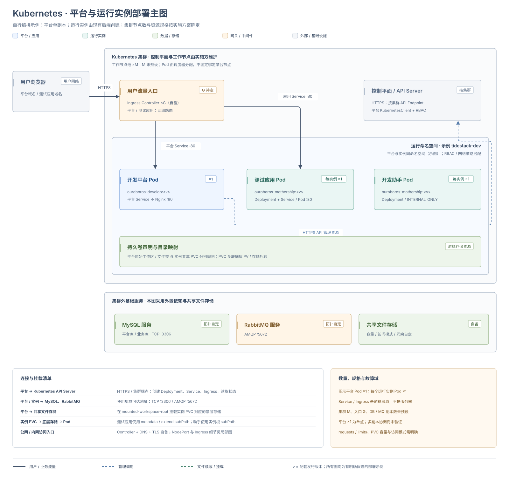
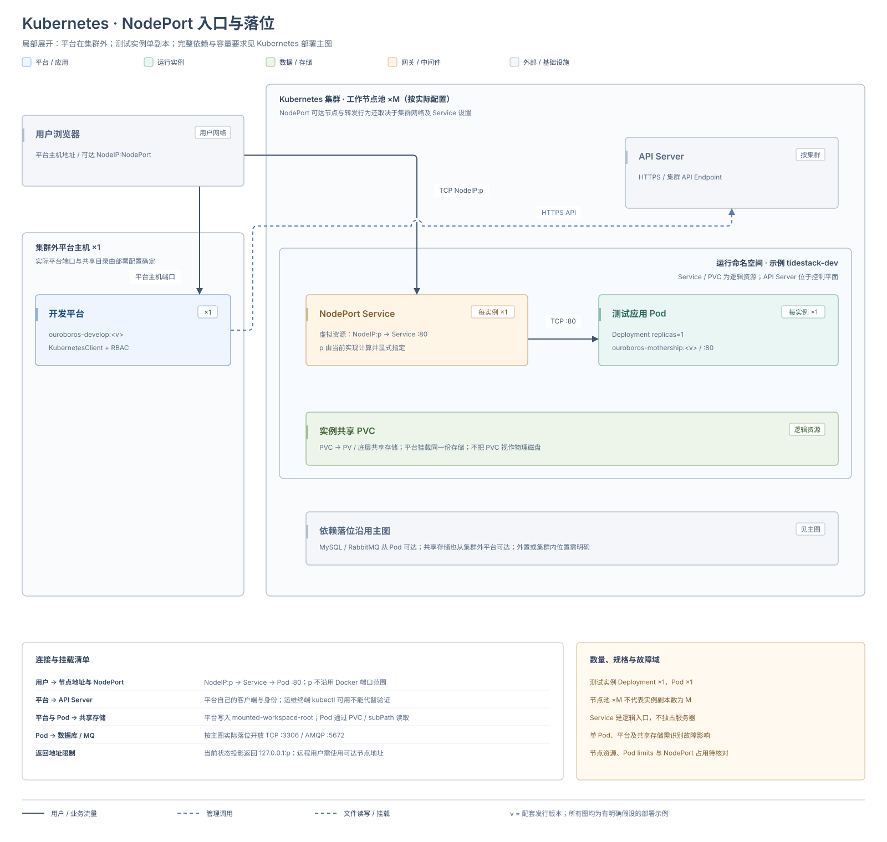
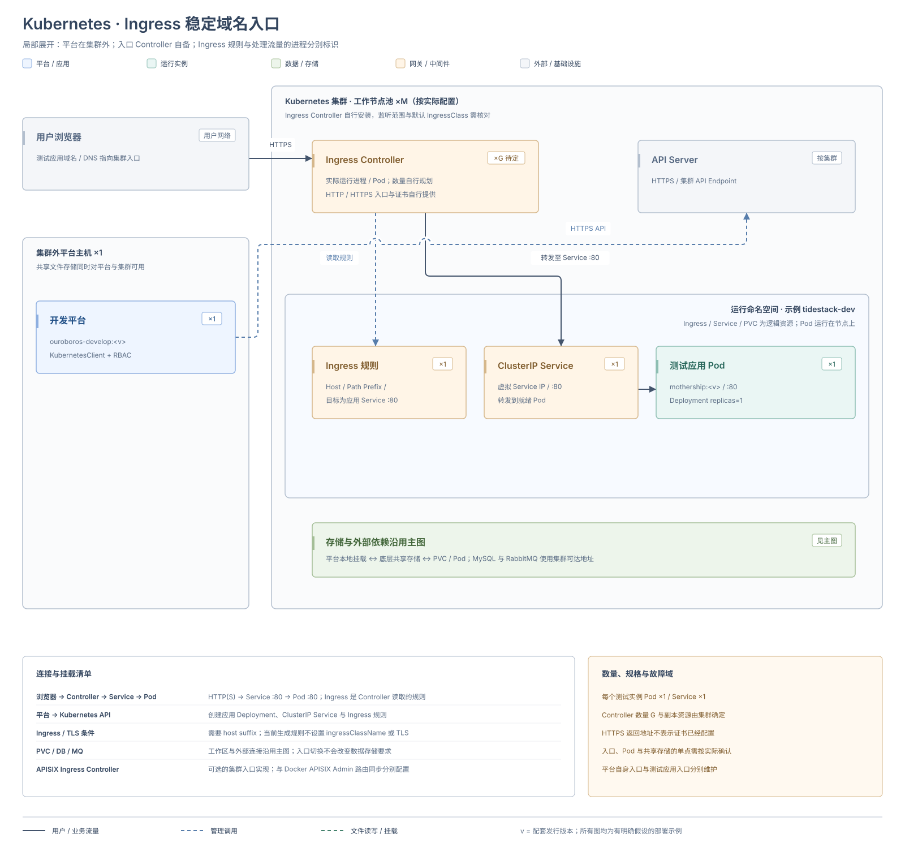
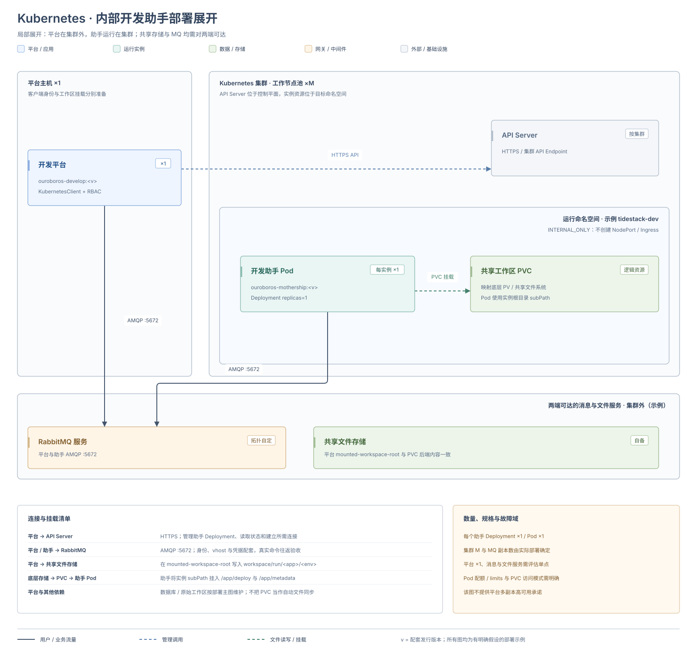

# Kubernetes 部署

Kubernetes 后端用于承载测试应用和内部开发助手。开发平台可以继续运行在集群外，也可以自行编排到集群内；平台承载位置与实例后端分别配置。

| 部署对象 | 当前交付与操作入口 |
| --- | --- |
| 集群外的开发平台 | 可以按 [Docker Compose 部署](./docker-compose) 安装，再按本页接入集群 |
| 开发运行实例 | 已有 `KUBERNETES` 后端，按本页准备客户端、权限、共享工作区与访问入口 |
| 集群内的开发平台 | 已有平台镜像，需要 [自行编排平台资源](#platform)；仓库没有配套平台 Helm chart 或完整安装清单 |
| 正式业务应用 | 使用团队自己的制品与部署流程，见 [业务应用发布与回退](../application-release-and-rollback) |

## 部署架构



主图采用平台与运行实例在同一集群、同一示例命名空间，MySQL、RabbitMQ 和共享文件服务外置的自行编排方案。平台 Pod 为单副本，每个测试应用和助手也为单副本；集群节点数、Controller 副本数、资源规格与数据服务冗余由实施方确定。已有集群或外部服务不应被默认视为高可用。

实线表示用户或业务流量，蓝色虚线表示管理调用，绿色虚线表示文件读写或挂载。Service、Ingress、PVC 是逻辑资源，分别对应实际入口进程、后端 Pod 和底层存储；API Server 位于集群控制平面，不属于运行命名空间。下文局部图另展示平台在集群外时的 NodePort、Ingress 与助手链路，所需数据库、消息和共享存储仍按实际主图落位维护。

## 环境要求

| 对象 | 要求 |
| --- | --- |
| 集群与工具 | 目标命名空间已创建，运维终端可以使用 `kubectl` 检查资源 |
| 平台客户端 | 平台进程内装配可用的 `KubernetesClient` Bean，并能访问 Kubernetes API；当前自动配置以已有客户端为前提 |
| 身份与权限 | 平台实际使用的身份具有管理实例资源、读取状态及建立所需连接的权限；按使用功能准备 RBAC |
| 共享存储 | 共享 PVC 为 `Bound`，容量与访问模式满足平台、测试应用和助手的实际运行位置 |
| 镜像 | 节点可以拉取配套镜像，架构与节点一致；准备所需仓库凭据 |
| 数据与消息 | 平台与实例都可访问数据库、RabbitMQ 和所需外部服务，并使用配套凭据 |
| 用户入口 | 预先选定 NodePort 或 Ingress，准备相应节点地址、域名、端口与证书 |
| 持久化与容量 | 平台配置、工作区、文件和依赖数据有持久化与备份；按并行实例、JVM、日志增长和恢复空间规划资源 |

`kubectl` 可用只说明运维终端具备访问能力，还要验证平台进程实际使用的客户端和身份。仅修改后端环境变量不会装配客户端、创建命名空间或准备 PVC。

## 1. 准备开发平台

集群外的平台先按 [Docker Compose 部署](./docker-compose) 完成目录、依赖、持久化、启动和首次登录，再调整实例后端。平台需要访问集群 API 和与实例一致的共享存储；容器网络中的数据库、RabbitMQ 服务名不会自动在集群内解析。

平台自身也放入 Kubernetes 时，先完成 [平台资源编排](#platform)，再继续后续步骤。不要直接照搬宿主机 Docker Socket 挂载作为集群运行方案。

## 2. 对齐共享工作区

平台先在本地挂载路径写入实例文件，再由 Pod 使用共享 PVC 读取。平台必须把 PVC 背后的同一份共享存储挂载到 `mounted-workspace-root` 对应路径；只创建 PVC 不会把平台文件自动送入集群。

核对平台原始工作区、实例共享目录、PVC、subPath 与 Pod 挂载内容，分别验证平台写入和 Pod 读取。平台在集群外时，共享存储应同时能被平台主机和集群节点访问；平台在集群内时，卷的访问模式应支持预期的跨 Pod、跨节点使用。

## 3. 注入运行后端配置

可在平台实际读取的 `application.yml` 中配置。以下命名空间、PVC 和域名均为示例，需替换为已准备的资源：

```yaml
ouroboros:
  dev:
    runtime:
      default-backend: KUBERNETES
      kubernetes:
        namespace: tidestack-dev
        shared-pvc-name: tidestack-dev-workspace
        mounted-workspace-root: /workspace
        helper-ready-timeout: 45s
        ingress-host-suffix: dev.example.com
```

通过容器直接配置时，对应环境变量为：

| Spring 配置键 | 平台容器环境变量 | 本例值 |
| --- | --- | --- |
| `ouroboros.dev.runtime.default-backend` | `OUROBOROS_DEV_RUNTIME_DEFAULTBACKEND` | `KUBERNETES` |
| `ouroboros.dev.runtime.kubernetes.namespace` | `OUROBOROS_DEV_RUNTIME_KUBERNETES_NAMESPACE` | `tidestack-dev` |
| `ouroboros.dev.runtime.kubernetes.shared-pvc-name` | `OUROBOROS_DEV_RUNTIME_KUBERNETES_SHAREDPVCNAME` | `tidestack-dev-workspace` |
| `ouroboros.dev.runtime.kubernetes.mounted-workspace-root` | `OUROBOROS_DEV_RUNTIME_KUBERNETES_MOUNTEDWORKSPACEROOT` | `/workspace` |
| `ouroboros.dev.runtime.kubernetes.helper-ready-timeout` | `OUROBOROS_DEV_RUNTIME_KUBERNETES_HELPERREADYTIMEOUT` | `45s` |
| `ouroboros.dev.runtime.kubernetes.ingress-host-suffix` | `OUROBOROS_DEV_RUNTIME_KUBERNETES_INGRESSHOSTSUFFIX` | `dev.example.com` |

Compose 放入平台服务的 `environment`，Kubernetes 放入平台容器的 `env`；需要凭据的通用参数使用部署环境的密钥注入方式。环境变量优先于同名文件配置，更改后重建或更新平台容器。

完整参数及默认值见 [开发平台配置项 / Kubernetes](../development-platform-configuration#kubernetes)。例如命名空间的代码默认值为 `default`，平台镜像内置值为 `ouroboros-dev`；助手就绪超时分别为 `45s` 与 `30s`，不能把本页示例值当作默认值。

在平台配置中心同步核对 `dev-app-management.test-app.preferred-runtime-backend`，设置为 `KUBERNETES`，或在创建请求中显式选择。测试应用的后端优先使用“创建请求 → 配置中心 → Spring 兜底值”；该配置中心键没有直接的 Spring 环境变量。改变默认后端不会迁移已有实例，切换前记录现有工作区、数据和端点。

## 4. 配置测试应用入口

测试应用的访问策略由创建请求或配置中心的 `dev-app-management.test-app.default-exposure-strategy` 决定，该键同样没有直接的 Spring 环境变量。

### NodePort 临时端口 {#nodeport}

选择 `KUBERNETES` / `TEMP_PORT`，平台创建单副本 Deployment 和 NodePort Service，流量经 Service 进入 Pod 的 `80` 端口，拓扑见 [NodePort 架构](../deployment-architecture#kubernetes-nodeport)。



确认实际使用的 NodePort、用户可访问的节点地址及网络放行规则。当前实现根据应用、环境与实例类型计算 NodePort，并在 Service 中显式指定；需要核对集群允许的端口范围与占用情况，不沿用 Docker 的 `8000-9000` 配置范围。

当前状态投影使用 `http://127.0.0.1:<NodePort>`。远程集群应从实例详情或 Service 取得实际 NodePort，结合可达的节点地址或既定转发入口验证，不能直接把回环地址交给远程用户。

### Ingress 稳定域名 {#ingress}

选择 `KUBERNETES` / `STABLE_DOMAIN`，并配置 `ingress-host-suffix`，平台创建单副本 Deployment、ClusterIP Service 和 Ingress，拓扑见 [Ingress 架构](../deployment-architecture#kubernetes-ingress)。



部署前完成以下准备：

- 部署 Ingress Controller，并确认默认 IngressClass 和资源监听范围。当前生成的 Ingress 不指定 IngressClass。
- 将实际后缀的 DNS 指向集群入口，规则按应用与环境生成主机名，将 `/` 前缀转发到应用 Service 的 `80` 端口。
- 自行配置 TLS 和证书。当前生成的 Ingress 不包含 TLS 设置；返回 `https://<域名>` 不代表证书已经就绪。

未配置域名后缀时不会创建 Ingress。使用 APISIX Ingress Controller 属于集群入口实现选择，仍需验证 IngressClass 和监听范围；它不使用 [Docker + APISIX 部署](./docker-apisix) 的容器名上游与平台 Admin API 路由同步。

## 5. 创建、验证并交接实例

1. 在 [运行实例](../../low-code/development-platform-menus/runtime-instance) 确认后端为 Kubernetes。
2. 填写集群可拉取的完整镜像引用，选择环境和数据源。
3. 创建实例，查看详情中的 Deployment、Service、Ingress 与访问端点。
4. 等待 Pod 就绪后，从用户实际网络打开 Web 入口并登录；按所选策略核对实际 NodePort 或域名。
5. 调用只读接口并完成一次测试写入，确认数据源与工作区正确。
6. 按后端支持的操作重启，确认应用与工作区内容仍然可用。
7. 按需验证调试或后端 API 会话，使用后关闭。

Pod 能启动不代表域名、Ingress 或调试端点能从用户网络访问，应分别验证。交接时记录平台版本、客户端身份、命名空间、PVC、共享路径、镜像、数据源与入口，并建立 [监控巡检](../monitoring-and-alerting) 和 [备份恢复](../backup-monitoring-and-troubleshooting)。

## 内部开发助手

Kubernetes 开发助手使用 `INTERNAL_ONLY`。平台通过 Kubernetes API 管理助手 Deployment，助手读取共享 PVC，通过 RabbitMQ 的内部命令链路与平台配合，拓扑见 [Kubernetes 开发助手架构](../deployment-architecture#kubernetes-helper)。



助手不需要测试应用的 NodePort 或 Ingress。确认客户端、权限、镜像、共享目录和消息连接后，用一次真实助手命令验证准备、执行与结果返回；调试会话另行验证生命周期和访问提示。

## 开发平台自身部署到集群 {#platform}

平台镜像可作为自行编排的起点，拓扑见 [平台集群部署架构](../deployment-architecture#platform-kubernetes)。

完整落位见本页 [部署架构](#部署架构) 主图。平台的原始工作区持久卷与运行实例共享 PVC 分别规划，不将两者自动视为同一个卷。

仓库没有提供完整的平台 Kubernetes 安装清单或 Helm chart，实施方需要准备并验证：

| 对象 | 编排与初始化要求 |
| --- | --- |
| 平台容器 | 固定平台镜像与配套基座版本，核对节点架构、资源和启动、健康探针 |
| 配置与凭据 | 注入数据库、RabbitMQ、平台密钥和本页后端参数；配置文件路径与实际镜像加载路径一致 |
| 持久化 | 挂载平台配置、原始工作区、共享实例目录、日志、上传文件和文档库，保证权限及目录映射正确 |
| 外部依赖 | 准备平台库、业务库、RabbitMQ、连接权限与备份，平台及运行实例均可访问 |
| 集群身份 | 装配 `KubernetesClient` Bean，绑定管理目标资源所需的身份和 RBAC |
| 平台访问 | 单独配置平台 Service、域名、入口及证书；这些资源与测试应用入口分别维护 |

启动后先检查平台日志和 `/actuator/health`，通过实际平台地址验证首页可访问且健康状态为 `UP`。首次启动且数据库没有用户时会创建 `admin`；未配置初始密码时，从平台容器日志中的 `Generated random password` 记录取得随机密码，登录后立即修改。

已有数据库不会重复执行首次用户初始化；没有随机密码时先确认是否为已有环境，不通过删除数据库重新初始化账号。初始密码配置对已有账号的影响见 [管理员初始化配置](../runtime-base-configuration#认证与初始化)。

完成平台登录、应用管理和核心菜单检查后，再执行本页的共享工作区、后端接入与实例验收。图中采用单个平台实例，平台多副本的工作区协调、并发或高可用需要另行设计与验证。平台自身的集群升级和恢复流程也由实施方准备。

## 巡检与排障

将命名空间及资源名称替换为实例详情中的实际值：

```bash
RUNTIME_NAMESPACE=tidestack-dev
kubectl get pods,deployments,services,ingresses,pvc -n "$RUNTIME_NAMESPACE"
kubectl get events -n "$RUNTIME_NAMESPACE" --sort-by=.lastTimestamp
kubectl describe pod <pod> -n "$RUNTIME_NAMESPACE"
kubectl logs <pod> -n "$RUNTIME_NAMESPACE" --since=15m --tail=500
```

| 现象 | 先检查 |
| --- | --- |
| 没有创建运行资源 | 平台日志、客户端装配、身份和权限 |
| Pod Pending | 调度事件、资源配额、PVC 绑定与访问模式 |
| ImagePullBackOff | 完整镜像引用、仓库凭据、节点架构和网络 |
| 启动后退出或不就绪 | Pod 日志、应用配置、依赖连接和共享工作区 |
| Pod 就绪但页面打不开 | Service、Ingress、DNS、证书和实际端点 |
| 工作区不同步 | PVC、挂载根路径和平台工作区映射 |

应用版本、镜像和数据需要配套恢复，`kubectl rollout undo` 不能替代完整业务回退，具体边界见 [业务应用发布与回退](../application-release-and-rollback)。
