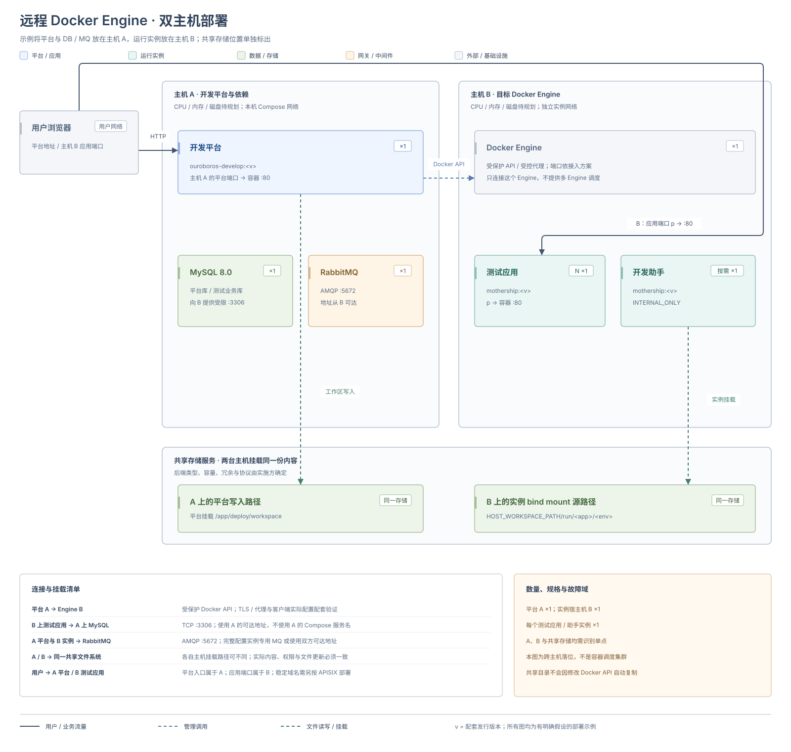

# 远程 Docker Engine 部署

本方式将开发平台与承载运行实例的 Docker Engine 放在不同主机。平台仍使用 `DOCKER` 后端，测试应用可以选择临时端口或 APISIX 稳定域名，内部开发助手使用 `INTERNAL_ONLY`。拓扑见 [远程 Docker Engine 架构](../deployment-architecture#remote-docker)。

远程 API 负责容器管理，实例文件通过共享文件系统提供。当前实现按配置连接一个 Engine，修改 API 地址不会自动复制工作区，也不提供多 Engine 调度。

## 部署架构



图中明确采用平台、MySQL 与 RabbitMQ 位于主机 A，目标 Engine、测试应用和助手位于主机 B，共享文件服务单独准备的落位。数据库与消息也可外置；无论放在哪里，均需使用两端可达地址并识别单点。

实线表示用户或业务流量，蓝色虚线表示管理调用，绿色虚线表示文件读写或挂载。图示采用临时端口入口；稳定域名模式的网关链路见 [Docker + APISIX 部署](./docker-apisix#部署架构)。

## 环境要求

| 对象 | 要求 |
| --- | --- |
| 平台主机 | 满足所选平台承载方式的要求；使用 Compose 时按 [Docker Compose 部署](./docker-compose#environment) 准备 |
| Engine 主机 | 可以拉取配套基座镜像，有足够资源，准备实例使用的 Docker 网络 |
| 管理链路 | 平台可通过受保护的 Docker API 或受控代理访问远端 Engine |
| 共享工作区 | 平台写入目录与 Engine bind mount 使用的宿主机目录指向同一份共享文件系统，读写权限一致 |
| 实例依赖 | 远端实例可访问实际数据库、RabbitMQ 及所需外部服务；平台主机上的 Compose 服务名不会自动在远端解析 |
| 用户入口 | 临时端口使用远端主机的可达地址；稳定域名模式要求 APISIX 能解析并访问远端容器 |

Docker API 接入方式需要与实际客户端及容器内证书或代理配置配套验证。配置中的 `docker-api.username` / `password` 被客户端用于镜像仓库账号，不会建立 Docker API 鉴权或 TLS；不开放无认证的 `2375`。

## 1. 准备并初始化平台

采用 Compose 承载平台时，按 [Docker Compose 部署](./docker-compose) 准备目录、数据库、RabbitMQ、持久化和平台首次登录。先不要创建依赖远端工作区的运行实例。

已有环境切换前记录实例、镜像、工作区、数据库和端点，并备份配置。新默认值只用于后续创建，不会把本机已有容器迁到远端。

## 2. 对齐两端工作区

例如平台容器仍从 `/app/deploy/workspace` 读写，远端 Engine 主机将同一份共享文件系统挂载到 `/srv/tidestack/workspace`。此时 `HOST_WORKSPACE_PATH` 必须填写远端宿主机路径 `/srv/tidestack/workspace`，平台容器内路径继续由挂载与 `ouroboros.dev.workspaceRoot` 确定。

两端目录名称可以不同，但内容必须对应。分别用平台进程和 Engine 主机的实际身份验证文件可见性及读写权限。只在两台主机上创建同名空目录不能满足要求。

## 3. 配置远端 Engine、网络和依赖

在平台服务的现有 `environment` 中修改以下参数，替换成实际值；API 地址须已按所选保护方案准备完成。

| 平台容器环境变量 | 填写内容 |
| --- | --- |
| `OUROBOROS_DEV_RUNTIME_DEFAULTBACKEND` | `DOCKER` |
| `OUROBOROS_DEV_CONTAINER_DOCKERAPI_HOST` | 平台实际可连接的受保护 Engine 或受控代理地址 |
| `HOST_WORKSPACE_PATH` | 共享文件系统在远端 Engine 宿主机上的绝对路径 |
| `OUROBOROS_DEV_WORKSPACEROOT` | 平台容器内实际工作区路径，例如 `/app/deploy/workspace` |
| `OUROBOROSDEV_CONTAINER_DEFAULTNETWORKNAME` | 远端 Engine 中已准备的实例网络名 |

远端网络应显式配置，避免误用平台容器所在本机网络。平台改为只管理远端 Engine 后，移除不再使用的本机 Docker Socket 挂载。

运行实例默认沿用平台的 RabbitMQ 连接。若平台配置使用 `ouroboros-rabbitmq` 等本机 Compose 服务名，改为两端均可访问的地址，或完整设置 [实例专用 RabbitMQ 参数](../development-platform-configuration#docker)。专用地址生效后应配齐账号、密码等字段，不能假定逐字段继承。测试应用的数据源也应使用远端实例可达的数据库地址。

检查部署配置并重建平台服务；Compose 平台可执行：

```bash
docker compose config --quiet
docker compose up -d --no-deps --force-recreate ouroboros-develop
docker compose logs --since 10m --tail 500 ouroboros-develop
```

## 4. 选择入口并验证

1. 在平台配置中心或创建请求中选择 `DOCKER`，核对目标 Engine 上可用的完整镜像引用。
2. 使用 `TEMP_PORT` 时，按实例实际端口配置远端主机的网络访问，确认用户能访问的主机地址。
3. 使用 `STABLE_DOMAIN` 时，继续 [Docker + APISIX 部署](./docker-apisix)，使网关与应用处于远端的共享网络。
4. 创建专门的测试实例，在目标 Engine 确认容器、工作区挂载和网络；从用户实际网络完成登录、查询和一次写入。
5. 验证平台能读取实例状态、日志，并对测试实例执行停止和再次运行。
6. 使用开发助手时，执行一次真实助手命令，确认消息传递和结果返回。

应用端口、容器网络和本地镜像均属于目标 Engine。若端点返回回环地址或平台主机地址，应结合远端实际地址及既定转发入口核验，不把错误地址交给用户。

交接时记录两端共享目录映射、Engine 接入方式、依赖连接、网络、镜像与入口。恢复时需要同时恢复工作区和对应数据库，见 [备份与恢复](../backup-monitoring-and-troubleshooting)。
