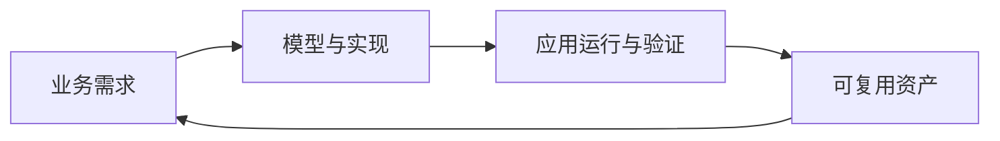

# 潮汐栈

以业务语义为中心，让 AI 与开发者协同构建企业应用。

从业务建模到应用交付，让页面、流程与代码在同一平台持续演进。

对于开发者，这意味着从业务对象、关系、规则和权限出发，组合页面、接口与流程；通用能力由平台提供，业务差异通过模型配置和代码扩展实现。AI 可以参与理解需求、生成实现和检查结果，开发者负责业务判断、设计取舍与交付验收。

## 以模型建立共同的业务语言

企业应用需要回答：有哪些业务对象，它们如何关联，谁可以执行什么操作，操作遵循哪些规则。潮汐栈用模型保存这些含义，让需求讨论、应用实现和后续维护有共同依据。

例如，一个订单模型可以同时描述订单属性、明细关系、提交与审核动作、状态变化和访问权限。数据、页面、接口与流程围绕这些定义展开，减少在各个实现中重复表达同一条业务规则的工作。

这种方式强调声明式开发：开发者说明应用需要什么、遵循什么约束，平台提供通用的页面呈现、数据访问和规则执行能力。模型保留明确的结构与约定，既便于开发者阅读、比较和维护，也为 AI 理解业务、生成定义和执行校验提供依据。

模型的职责与协作方式见 [概念与设计](./concepts/)。

## 低代码、代码与 AI 协同开发

### 通用需求通过建模与配置完成

标准列表、表单、详情、权限和流程，可以通过已有模型、组件与可视化编排实现。开发者主要确定业务内容和规则，并在运行环境中验证行为。

平台以二八原则指导开发取舍：用低代码承接大量通用需求，把更多精力投入真正形成业务差异的功能。具体采用哪种方式，取决于需求与已有能力。

### 特殊需求通过代码扩展

需要复杂交互、专用算法或特殊协议时，可以编写前端组件、微前端或后端扩展，再由应用模型引用这些能力。扩展继续使用平台的身份、权限和运行机制，能够与已有配置组合。

开放性体现在标准、契约和能力组合上。平台通过明确的扩展点接入新能力，开发者可以沿用熟悉的工程工具；核心组件也在逐步开源，便于理解、验证和参与改进。具体组件与开放进展见 [官网](https://www.tidestackforge.com/)。

### AI 参与整个开发过程

AI 可以读取业务模型、Schema、手册和项目实现，协助拆解需求，修改模型、页面、流程或扩展代码，再根据校验、测试和运行反馈修正结果。模型中的业务含义与格式约束，为人与 AI 提供共同的工作依据。

使用时，开发者需要提供目标应用、已有资产、业务规则与验收要求，并评审最终结果。AI 的产出进入项目已有的模型、代码、测试和版本管理流程。准备助手上下文与工具入口，见 [AI 入口](./ai/)；完整开发过程见 [用 AI 完成功能开发](./fusion-development/ai-assisted-development)。

## 从一次交付到持续积累

潮汐栈希望每次开发都留下下一次能够继续使用的成果。模型保存业务知识，组件与扩展保存实现经验，版本记录保存经过验证的组合，运行反馈则成为下一轮改进的依据。

复用可以从一个控件、一段流程或一组业务模型开始。一组相互关联的模型能够保存某个领域的对象、关系、规则与行为，让后续应用在已有经验上继续建设。

团队可以先选择一个业务领域或一段流程，与既有系统通过接口衔接，再逐步扩大范围；也可以按组件的接入约定，在已有代码应用中复用开放组件。

持续定制时，公共定义与项目差异按分层方式保存，产品更新和项目定制可以分别维护。升级时仍需验证模型、扩展与实际业务的兼容性。

这些取舍背后的模型化、经验复用、标准先行、插件化与开闭原则，见 [设计理念](./concepts/#设计理念)。

## 从开发平台到应用运行

开发者使用开发平台设计应用，由运行时基座承载应用行为。两者围绕同一套应用定义协作。

| 产品形态 | 开发者用它做什么 |
| --- | --- |
| 开发平台 | 管理应用与模型，配置页面和流程，接入代码扩展，管理应用版本并进行测试运行 |
| 运行时基座 | 加载模型与扩展，呈现页面，提供接口，执行业务规则与权限控制 |

独立运维平台仍在规划中。当前开发平台提供版本留档和测试运行能力，生产部署、发布与恢复需要衔接团队已有的交付流程，具体见 [运维管理](./operations/)。

## 示例：构建一个订单审核应用

下面用一个示例需求说明这些能力如何配合：销售录入订单，主管审核，审核通过后同步 ERP，调度人员在专用页面安排交付。

1. **明确业务规则。** 确定订单与明细的信息、允许提交和审核的状态、人员职责，以及同步失败时如何处理。
2. **建立模型与标准页面。** 用业务模型定义订单、明细及其关系，配置列表、表单和详情，定义提交与审核动作及访问权限。
3. **组合流程与集成。** 用审批流承接人工审核，用逻辑流和外部接口处理 ERP 同步。现有接口适配不足时，通过后端扩展补充能力。
4. **实现差异化交互。** 为复杂调度增加组件或微前端页面，继续调用同一应用的业务接口并遵守权限约束。
5. **验证并交付。** 在测试环境检查正常、驳回、同步失败和无权限等场景，记录配套的模型、前后端产物与运行版本，再按部署流程交付。

AI 可以协助上述各阶段的分析、实现与检查。经过验证的审批流程、集成适配和页面组件，也可以继续用于同类应用。

同样的方式适用于客户、合同、资产等业务管理，申请审批与协同，系统集成和业务工作台。按需求查找已有能力，见 [平台能力地图](./reference/platform-capability-map)。

## 从哪里开始

| 当前任务 | 入口 |
| --- | --- |
| 创建并运行第一个应用 | [快速上手](./getting-started/) |
| 配置模型、页面、流程和权限 | [低代码开发](./low-code/) |
| 结合模型、代码与 AI 完成功能 | [融合开发](./fusion-development/) |
| 查方法、参数与元数据格式 | [参考资料](./reference/) |
| 部署、发布、备份与排障 | [运维管理](./operations/) |
| 理解模型职责与关系 | [概念与设计](./concepts/) |

产品名称使用“潮汐栈”；Maven 坐标、Java 包名和 SDK 导入保留 `Ouroboros / ouroboros` 技术标识。
